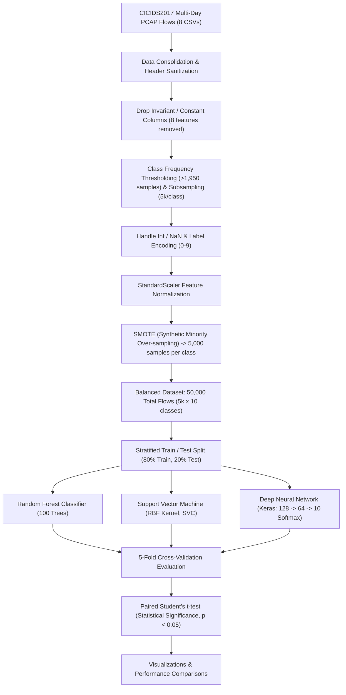

# 🛡️ CICIDS2017 Multi-Class Network Intrusion Detection System (NIDS)
### Multi-Class Cyber Attack Classification with SMOTE, Deep Learning (Keras), & Statistical Hypothesis Testing

[](https://www.python.org/)
[](https://scikit-learn.org/)
[](https://www.unb.ca/cic/datasets/ids-2017.html)
[]()
[]()

---

## 📌 1. Project Overview (Ta'aruf / Introduction)

Yeh project **CICIDS2017 (Canadian Institute for Cybersecurity)** benchmark network dataset par mabni ek comprehensive **Multi-Class Network Intrusion Detection System (NIDS)** hai.

Iska maqsad normal network traffic (**BENIGN**) aur **10 mukhtalif cyber attacks** (DDoS, DoS Hulk, PortScan, FTP-Patator, SSH-Patator, Bot, etc.) ko accurately detect aur classify karna hai.

Is project ki sabse bari khasiyat:
1. **SMOTE (Synthetic Minority Over-sampling Technique)** ka istemal class imbalance ko khatam karne ke liye.
2. **Deep Neural Network (Keras / TensorFlow)** aur Machine Learning (Random Forest, SVM) ka direct comparative benchmark.
3. **Statistical Significance Hypothesis Testing (Paired Student's t-tests)** jo mathematically ($p < 0.05$) prove karti hai ke Random Forest statistically significantly behtar perform karta hai.

---

## 🎯 2. Attack Classes Covered (10 Classes)

Is system mein CICIDS2017 ke 10 major traffic categories ko classify kiya gaya hai:

| Class ID | Attack Category | Threat Type | Description |
| :---: | :--- | :--- | :--- |
| **0** | **BENIGN** | Normal | Standard authorized network traffic (HTTP, HTTPS, SSH, etc.) |
| **1** | **Bot** | Malware C2 | Ares Botnet command-and-control communication |
| **2** | **DDoS** | Network Flood | Distributed Denial of Service (LOIC attack) |
| **3** | **DoS GoldenEye** | App Layer DoS | GoldenEye HTTP Keep-Alive connection exhaustion |
| **4** | **DoS Hulk** | App Layer DoS | HTTP Unbearable Load King request flooding |
| **5** | **DoS Slowhttptest**| Low & Slow DoS | Slow HTTP request pipeline exhaustion |
| **6** | **DoS slowloris** | Connection DoS | Holding HTTP connections open by sending partial headers |
| **7** | **FTP-Patator** | Brute Force | Multi-threaded FTP credential guessing attacks |
| **8** | **PortScan** | Reconnaissance | Network service discovery and port vulnerability scanning |
| **9** | **SSH-Patator** | Brute Force | Multi-threaded SSH credential brute-forcing |

---

## 🏗️ 3. System Architecture & Methodology



---

## 🏆 4. Verified Model Performance Benchmarks

### Test Set Evaluation (20% Holdout):

| Evaluation Metric | Random Forest (RF) | Support Vector Machine (SVM) | Keras Deep Neural Network |
| :--- | :---: | :---: | :---: |
| **Accuracy** | **99.74%** | 98.08% | **99.09%** |
| **Precision** | **0.9974** | 0.9808 | **0.9909** |
| **Recall** | **0.9974** | 0.9806 | **0.9908** |
| **F1-Score** | **0.9974** | 0.9804 | **0.9908** |
| **ROC-AUC Score** | **0.9996** | 0.9983 | **0.9994** |

---

## 🔬 5. Statistical Significance Testing (Hypothesis Testing)

5-Fold Cross-Validation scores par **Paired Student's t-tests** run kiye gaye:
- **Null Hypothesis ($H_0$):** Models ki performance mein koi real farq nahi hai (performance difference random noise hai).
- **Alternative Hypothesis ($H_1$):** Models ke darmian performance difference statistically meaningful aur consistent hai.
- **Significance Level:** $\alpha = 0.05$.

### Key Findings:
1. **Random Forest vs SVM:**
   - $t = 24.68$, $p = 0.000016$ ($p < 0.05$)
   - ✅ **STATISTICALLY SIGNIFICANT:** Random Forest outperforms SVM decisively across all 5 metrics.
2. **Random Forest vs Neural Network:**
   - $t = 10.47$, $p = 0.000470$ ($p < 0.05$)
   - ✅ **STATISTICALLY SIGNIFICANT:** Random Forest outperforms Keras Neural Network consistently across all cross-validation folds.
3. **Neural Network vs SVM:**
   - $t = -14.15$, $p = 0.000145$ ($p < 0.05$)
   - ✅ **STATISTICALLY SIGNIFICANT:** Keras Neural Network significantly outperforms standard SVM.

---

## 📥 6. Dataset Download & Setup

Dataset files (~1 GB) large size ki wajah se `.gitignore` mein rakhi gayi hain. Kisi bhi new user ko chalane ke liye:

1. **Dataset Sources:**
   - [Canadian Institute for Cybersecurity (CIC) UNB Portal](https://www.unb.ca/cic/datasets/ids-2017.html)
   - [Kaggle CICIDS2017 Dataset Mirror](https://www.kaggle.com/datasets/cicdataset/cicids2017)
2. **Placement:** Download ki gayi CSV files ko project ke root directory mein rakhein.

---

## 🚀 7. Installation & Quickstart

```bash
# 1. Virtual environment banayein
python -m venv venv
venv\Scripts\activate

# 2. Dependencies install karein
pip install -r requirements.txt

# 3. Jupyter Notebook open karein
jupyter notebook Untitled.ipynb
```

---

## 📜 8. Project Authors & Citation

> **Canadian Institute for Cybersecurity (CIC)**  
> University of New Brunswick (UNB)  
> *Iman Sharafaldin, Arash Habibi Lashkari, and Ali A. Ghorbani, "Toward Generating a New Dataset for Cybersecurity Analysis", ICISSP 2018.*
